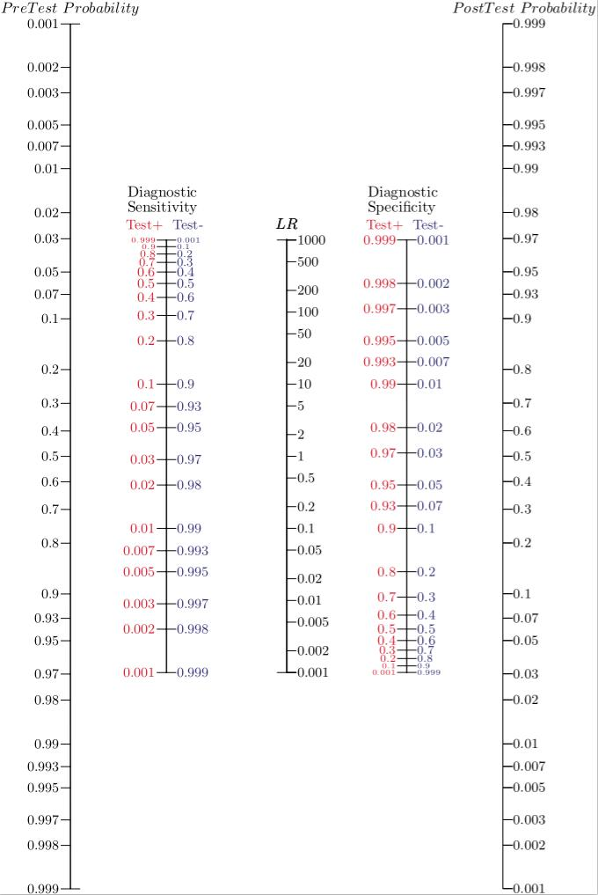
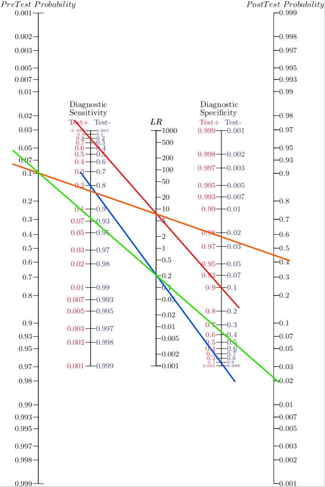

## Objetivos de aprendizaje.
 
  * Comprender los fundamentos de la validación diagnóstica en biomedicina.
  * Construir e interpretar correctamente tablas de contingencia de $2 \times 2$.
  * Calcular e interpretar analíticamente la sensibilidad, la especificidad, el valor predictivo positivo (VPP) y el valor predictivo negativo (VPN).
  * Analizar el impacto crítico de la prevalencia de la enfermedad mediante el Teorema de Bayes aplicado a la práctica clínica.

---

## Introducción.

### Marco conceptual: Validez vs. fiabilidad

Antes de entrar en los pormenores de la validación diagnóstica, conviene precisar dos dimensiones de la calidad de la medida que a menudo se confunden.

  * **Fiabilidad (repetibilidad / concordancia / reproducibilidad):** Grado en que un instrumento ofrece el mismo resultado cuando se aplica en repetidas ocasiones bajo las mismas condiciones (ausencia de error aleatorio).
  
  * **Validez (exactitud / exactitud de medida):** Grado en que un instrumento mide realmente el fenómeno o variable que pretende medir (ausencia de error sistemático o sesgo).

> **Aclaración terminológica:** La *concordancia* o *reproducibilidad* entre mediciones repetidas pertenece al ámbito de la **fiabilidad**, no de la validez. Un instrumento puede ser altamente reproducible (dar siempre la misma cifra) y, sin embargo, carecer totalmente de validez (estar descalibrado o medir el concepto equivocado).

---

### Abordajes clásicos para evaluar la validez

  Cuando nos preguntamos si nuestra prueba o instrumento es *válido*, la respuesta depende del tipo de variable y de si disponemos o no de una referencia absoluta. Tradicionalmente se distinguen tres formas de abordar la validez:

1. **Validez de contenido:** 

   * Evalúa si el instrumento incluye una muestra representativa y exhaustiva de todas las **dimensiones** del concepto que se desea medir. 
   * Es un juicio predominantemente teórico o de expertos (frecuente en escalas de calidad de vida o cuestionarios de síntomas).

2. **Validez de constructo:** 

   * Se utiliza cuando la variable de interés es un concepto abstracto ("constructo") que no se puede observar directamente ni medir con un estándar físico (ej. *burnout*, depresión, fragilidad).
   * Se evalúa comprobando si la prueba se comporta tal como predice la teoría (mediante validez convergente con otros tests similares, o discriminante frente a conceptos distintos).

3. **Validez de criterio (o diagnóstica):** 

   * Se evalúa comparando los resultados de la nueva prueba o medición con una **regla de oro** (*gold standard* o criterio de referencia) que determina la presencia o ausencia real de la enfermedad o rasgo.
   * Se subdivide en:
     * *Validez concurrente:* La nueva prueba y el criterio de referencia se aplican simultáneamente.
     * *Validez predictiva:* La prueba evalúa la capacidad de predecir un evento que ocurrirá en el futuro.

---


  En epidemiología clínica, cuando evaluamos una **prueba diagnóstica**, un biomarcador o una escala de cribado frente a una enfermedad concreta, estamos hablando fundamentalmente de la **validez de criterio**.

  A lo largo de este tema y el siguiente nos centraremos de manera exclusiva en este abordaje:

  * ¿Cómo cuantificamos la validez de criterio de una prueba dicotómica? (**Sensibilidad** y **especificidad**).
  * ¿Cómo varía su rendimiento según el punto de corte en variables continuas? (**Curvas ROC** y **área bajo la curva**).
  * ¿Cómo trasladamos esta validez intrínseca a la práctica clínica real? (**Valores predictivos** y **razones de verosimilitud / *likelihood ratios***).


### Teorema de Bayes aplicado al diagnóstico:

  En las notas de repaso sobre probabilidad condicionada usábamos $A$ y $B$ para referirnos a dos sucesos no independientes.  
  
  Para acercarlo a la interpretación clínica, vamos a aplicarlo al diagnóstico asumiendo que $A$ es la presencia de la una Enfermedad ($E$) y $B$ es la presencia de un síntoma ($S$).


  El T. de Bayes aplicado a una causa binaria $(E , \bar{E})$ permite entender los factores que relacionan la probabilidad anterior $P(E)$ y la $P({E  \mid S})$.
  
  Así, la expresión general...
  
   $$P(A \mid B) = \frac{P(A) \cdot P(B \mid A)}{P(A) \cdot P(B \mid A)+P(\bar{A}) \cdot P(B \mid \bar{A})}$$
  aplicada a su uso para el diagnóstico de una enfermedad tras conocer que se ha dado un síntoma quedaría de la siguiente manera.
 
  $$P(E \mid S) = \frac{P(E) \cdot P(S \mid E)}{P(E) \cdot P(S \mid E)+P(\bar{E}) \cdot P(S \mid \bar{E})}$$
A lo largo de la formación de muchos/as profesionales clínicos suele ofrecérseles información sobre la frecuencia con la que aparecen determinados síntomas en una enfermedad dada ($P(S|E)$). Sin embargo, en la práctica clínica la pregunta clave es otra probabilidad condicionada $P(E|S)$ (recuerde que estas dos probabilidades no son complementarias entre sí).

  En esta *"inversión de las condiciones"* es donde cobra relevancia este teorema.

 

## Validación diagnóstica.

  Todas las probabilidades condicionadas que aparecen en la formulación anterior puede calcularse en tablas de contingencia que enfrenten el resultado del test diagnóstico o el síntoma con el *gold standar* que define la enfermedad, en teoría, no siempre, de manera inequívoca.
  
  

### Estructura de la Matriz $2\times2$

  En investigación clínica, validar una nueva prueba diagnóstica requiere enfrentar su resultado frente a un patrón de referencia u *gold standard* (patrón oro). 

  La estructura básica se resume en la siguiente tabla[^1].

  En función de la relación entre el resultado y la verdad, al menos la verdad medida por el *gold standard*.

  [^1]: Aunque la siguiente tabla utiliza el resultado de un test, positivo podría ser en realidad cualquier característica (p.ej. un síntoma, una característica..) que se asocie con la aparición de la enfermedad, y el resultado negativo sería su complementario (no tener el síntoma, la característica...)  :
  
  | | Enfermo ($D+$) | Sano ($D-$) | Total |
  | :--- | :---: | :---: | :---: |
  | **Positivo ($T+$)** | $VP$ | $FP$ | $VP + FP$ |
  | **Negativo ($T-$)** | $FN$ | $VN$ | $FN + VN$ |
  | **Total** | $VP + FN$ | $FP + VN$ | $N$ |
  
  $VP$: Verdaderos Positivos 
  $FP$: Falsos Positivos
  $FN$: Falsos Negativos
  $VN$. Verdaderos Negativos

---

### Parámetros principales de validez y rendimiento.

  En una prueba que devuelve un resultado binario (presencia/ausencia; positivo/negativo...) podemos estimar la validez de dicha prueba mediante dos medidas (en el fondo frecuencias relativas): la sensibilidad (s) y la especificidad. La primera habla de los sujetos que, según el *Gold Standard*, tienen la enfermedad y la segunda de los sujetos que no la tienen, son por tanto probabilidades condicionadas al grupo a la pertenencia a uno u otro grupo.

  * **Sensibilidad (s):** Probabilidad de que la prueba sea positiva en pacientes enfermos.
    $$\text{s} = \frac{VP}{VP + FN}$$
    
  * **Especificidad (e):** Probabilidad de que la prueba sea negativa en pacientes sanos.
    $$\text{e} = \frac{VN}{FP + VN}$$

  Por su parte, los valores predictivos son también probabilides condicionadas, en los que la condicion es el resultado obtenido.
  
  
  * **Valor Predictivo Positivo (VPP):** Probabilidad de que un paciente con resultado positivo esté realmente enfermo.
    $$\text{VPP} = \frac{VP}{VP + FP}$$
    
  * **Valor Predictivo Negativo (VPN):** Probabilidad de que un paciente con resultado negativo esté realmente sano.
    $$\text{VPN} = \frac{VN}{FN + VN}$$
    
    
  Se suele aceptar que la sensibilidad y la especificidad de la prueba son las mismas siempre. En realidad esto es solo teórico, porque la validez del test viene condicionado por otras circunstancias como la pericia de los técnicos, las condiciones del laboratorio (humedad, temperatura) o características biológicas (conocidas o no) que también lo afecten. 

  Lo que sí es cierto es que si eliminásemos todos estos condicionantes, la validez de la prueba no dependería de la frecuencia de la enfermedad, algo que sí afecta a la probabilidad posterior (los valores predictivos en este ejemplo).


#### Factor de Bayes 

  Como hemos comentado anteriormente, el factor de bayes  establece cuánto más probable es que se produzca $A$ cuando se ha producido $B$ que cuando no se ha producido $B$, es decir cuando se ha producido $\bar{B}$, pero la lógica se entiende mejor cuando trabajamos con `odds` en vez de con probabilidades. En términos de enfermedad y síntoma, cuánto más probable es que se produzca $E$ cuando observamos que aparece el síntoma $S$ que cuando no se ha producido $\bar{S}$
  
  El factor de Bayes, permite relacionar de una manera mucho más cercana la probabilidad previa (*a priori*) con la probabilidad posterior (*a posteriori*), pero lo hace a través de las `odds`.
  
  Recordamos aquí el concepto de `odd` y cómo movernos desde esta a la probabilidad y viceversa.

$$odd = \frac{p}{1-p}$$
$$p = \frac{odd}{1+odd}$$

Dada esta relación entre `odds` y `probabilidad`, consideramos un síntoma y una enfermedad que no son independientes, es decir, que el conocimiento de que ha aparecido uno de ellos modifica nuestro conocimiento de la probablidad del otros. No olvide que esta relación matemática es bidireccional aunque la causal no lo sea. 

Así pues, podemos expresar $P(E|S) = \frac{Odd(E|S)}{1+Odd(E|S)}$.

A su vez:


$${Odd(E \mid S)}=\frac{P(E \mid S)}{P(\bar{E}\mid S)}$$
$$Odd(E \mid S)=\frac{\frac{P(E \cap S)}{P(S)}}{\frac{P(\bar{E} \cap S)}{P(S)}}$$
Aplicando la ley multiplicativa de la probabilidad, podemos sustituir las intersecciones.


$$Odd(E \mid S)=\frac{\frac{P(E)·P(S|E)}{\cancel{P(S)}}}{\frac{P(\bar{E})·P(S|\bar{E})}{\cancel{P(S)}}}$$
y simplificando


$$Odd(E \mid S)=\frac{P(E)·P(S|E)}{P(\bar{E})·P(S|\bar{E})}$$
$$Odd(E \mid S) = Odd(E)·\frac{P(S|E)}{P(S|\bar{E})}$$

$$Odd(E \mid S) = Odd(E)·\text{fb}$$

En epidemiología, el factor de bayes se llama Razón de Verosimilitud (RV), Likelihood Ratio (LR) en inglés. 

Para facilitar se interpretación se suele hablar de Razón de verosimilitud positiva (test + ) o negativa (test -).

Pero lo importante es entender que el factor de bayes es una razón de probabilidades sobre la presencia de un resultado (+ o -), de un síntoma (${S}$ y $\bar{S}$) o de cualquier característica, en un grupo (en el ejemplo, los enfermos) frente a otro (en el ejemplo, los sanos). En general, cualquier característica no independiente (desde el punto de vista probabilístico) del resultado del test, síntoma, característica y que por lo tanto aporte información (modifique la probabilidad) del evento de interés, en este caso la presencia de enfermedad.

Si hablamos de la presencia de un síntoma no independiente, es decir, más probable  en enfermos que en sanos, de la enfermedad [^nota_fb], y sabiendo que:

  * **Sensibilidad (s):** Probabilidad de que la prueba sea positiva en pacientes enfermos.
    $$\text{s} = \frac{VP}{VP + FN}$$
    
  * **Especificidad (e):** Probabilidad de que la prueba sea negativa en pacientes sanos.
    $$\text{e} = \frac{VN}{FP + VN}$$
    
La odd posterior quedaría así:
    
$$Odd(E \mid S) = Odd(E)·\frac{s}{1-e}$$
[^nota_fb]: En realidad lo que importa es que sea diferentemente probable para que nos ayude a discriminar, pero para el ejemplo pensaremos en a un síntoma que señale a la enfermedad y que por tanto sea más probable en enfermos que sanos.

Algo que, en principio, depende solo de la validez del test. 

Como se puede observar, esto simplifica la aplicación del teorema de Bayes, dado que depende solo de la probabilidad previa $P(E)$ y de la capacidad del test para identificar, para clasificar correctamente, para discriminar entre un enfermo y un sano. 

Como hemos comentado previamente, el factor de bayes 

  $$Odd(E \mid S) = Odd(E)·fb_{+}$$


### Influencia Crítica de la Prevalencia
  
  * **Independencia analítica:** La sensibilidad y la especificidad son, con los condicionantes comentados, propiedades intrínsecas de la prueba diagnóstica y no varían según la prevalencia de la enfermedad que se pretende diagnosticar en la población. [^nota_sye]
  
  * **Dependencia predictiva:** Por el contrario, los valores predictivos (VPP y VPN) dependen directamente de la prevalencia de la enfermedad en la población de estudio.
  
    $$\text{VPP} = \frac{\text{s} \times \text{Prevalencia}}{(\text{s} \times \text{Prevalencia}) + ((1 - \text{e}) \times (1 - \text{Prevalencia}))}$$
  * **Implicación práctica:** En escenarios de cribado (*screening* con baja prevalencia), el VPP disminuye de forma drástica, generando una alta proporción de falsos positivos que deben ser confirmados mediante pruebas adicionales.
  
[^nota_sye]: En rigor metodológico, la sensibilidad y la especificidad no son constantes biológicas fijas. Varían en la práctica debido a factores técnicos (toma y conservación de la muestra, kit o lote utilizado, variabilidad del laboratorio) y, de forma muy relevante, por el **efecto espectro** (la gravedad de los casos y la presencia de comorbilidades en los controles de la población analizada) y el sesgo del estándar de referencia. Sin embargo, asumimos su invariancia como una simplificación pedagógica útil para aislar el comportamiento de los valores predictivos frente a la prevalencia.

### Ejemplo práctico manual: cálculo directo y teorema de Bayes

Antes de automatizar el análisis en R, vamos a calcular paso a paso las métricas diagnósticas en una muestra piloto de $N = 1000$ **pacientes** para comprender la mecánica de la matriz de contingencia y su relación con el Teorema de Bayes.

Supongamos que evaluamos una nueva prueba diagnóstica frente al *gold standard* y obtenemos los siguientes resultados:

|  | Enfermo ($D+$) | Sano ($D-$) | Total | 
| ----- | ----- | ----- | ----- | 
| **Prueba Positiva (**$T+$**)** | 80 | 90 | **170** | 
| **Prueba Negativa (**$T-$**)** | 20 | 810 | **830** | 
| **Total** | **100** | **900** | **1000** | 

### Cálculo de parámetros de validez intrínseca

  * **Sensibilidad (s):** Probabilidad de que el test sea positivo en enfermos.
  

  $$
  \text{s} = \frac{VP}{VP + FN} = \frac{80}{80 + 20} = \frac{80}{100} = 0.80 \quad (\mathbf{80.0\%})
  $$

  
  *(El test detecta al 80% de los enfermos reales).*

  * **Especificidad (e):** Probabilidad de que el test sea negativo en sanos.
  

  $$
  \text{e} = \frac{VN}{FP + VN} = \frac{810}{90 + 810} = \frac{810}{900} = 0.90 \quad (\mathbf{90.0\%})
  $$

  
  *(El test descarta correctamente al 90% de los sanos).*

### Cálculo de valores predictivos (dependientes de la prevalencia)

* **Prevalencia real en la muestra:** $\frac{100}{1000} = 0.10$ ($10.0\%$).

* **Valor Predictivo Positivo (VPP):** Probabilidad de estar enfermo ante un test positivo.
  

  $$
  \text{VPP} = \frac{VP}{VP + FP} = \frac{80}{80 + 90} = \frac{80}{170} \approx 0.471 \quad (\mathbf{47.1\%})
  $$

* **Valor Predictivo Negativo (VPN):** Probabilidad de estar sano ante un test negativo.
  

  $$
  \text{VPN} = \frac{VN}{FN + VN} = \frac{810}{20 + 810} = \frac{810}{830} \approx 0.976 \quad (\mathbf{97.6\%})
  $$

> **Nota pedagógica:** Como se puede observar, los valores predictivos ($\text{VPP} = 47.1\%$, $\text{VPN} = 97.6\%$) difieren claramente de la sensibilidad y la especificidad ($80\%$ y $90\%$), evidenciando que miden conceptos distintos y están condicionados por la prevalencia poblacional.

### Cálculo de las razones de verosimilitud (*Likelihood Ratios*)

  * $\text{LR}^+$ **(Razón de verosimilitud positiva):**
  

  $$
  \text{LR}^+ = \frac{\text{s}}{1 - \text{e}} = \frac{0.80}{1 - 0.90} = \frac{0.80}{0.10} = \mathbf{8.0}
  $$

  
  *(Un resultado positivo es 8 veces más probable en un paciente enfermo que en uno sano).*

  * $\text{LR}^-$ **(Razón de verosimilitud negativa):**
  

  $$
  \text{LR}^- = \frac{1 - \text{s}}{\text{e}} = \frac{1 - 0.80}{0.90} = \frac{0.20}{0.90} \approx \mathbf{0.222}
  $$

### Demostración: Teorema de Bayes frente a Odds y Factor de Bayes

Para comprobar que el **Valor Predictivo Positivo (**$\text{VPP}$**)** no es más que la probabilidad a posteriori $P(E \mid T+)$, podemos llegar a él mediante dos caminos matemáticos que arrojan exactamente el mismo resultado:

#### A. Aplicando la fórmula clásica del Teorema de Bayes

Con una prevalencia $P(E) = 0.10$, $P(\bar{E}) = 0.90$, sensibilidad $P(T+ \mid E) = 0.80$ y tasa de falsos positivos $P(T+ \mid \bar{E}) = 1 - \text{e} = 0.10$:

$$
P(E \mid T+) = \frac{P(E) \cdot P(T+ \mid E)}{P(E) \cdot P(T+ \mid E) + P(\bar{E}) \cdot P(T+ \mid \bar{E})}
$$

Sustituyendo los valores:

$$
P(E \mid T+) = \frac{0.10 \times 0.80}{(0.10 \times 0.80) + (0.90 \times 0.10)} = \frac{0.08}{0.08 + 0.09} = \frac{0.08}{0.17} \approx 0.4706 \quad (\mathbf{47.1\%})
$$

#### B. Aplicando las *Odds* y el Factor de Bayes ($\text{LR}^+$)

El mismo cálculo se simplifica notablemente trabajando en la escala de *odds*:

  1. **Calculamos la *odds* previa (*pre-test*):**
   

   $$
   \text{Odds}(E) = \frac{P(E)}{1 - P(E)} = \frac{0.10}{0.90} = \frac{1}{9} \approx 0.1111
   $$

  2. **Multiplicamos por el Factor de Bayes (**$\text{LR}^+$**) para obtener la *odds* posterior (*post-test*):**
   

   $$
   \text{Odds}(E \mid T+) = \text{Odds}(E) \cdot \text{LR}^+ = \frac{1}{9} \cdot 8.0 = \frac{8}{9} \approx 0.8889
   $$

  3. **Convertimos la *odds* posterior de nuevo a probabilidad (el VPP):**
   

   $$
   P(E \mid T+) = \frac{\text{Odds}(E \mid T+)}{1 + \text{Odds}(E \mid T+)} = \frac{8/9}{1 + (8/9)} = \frac{8/9}{17/9} = \frac{8}{17} \approx 0.4706 \quad (\mathbf{47.1\%})
   $$

Ambos métodos demuestran de manera rigurosa que el razonamiento probabilístico clásico y el uso de *odds* con razones de verosimilitud son perfectamente equivalentes.

Si el resultado hubiese sido negativo:


  1. **Calculamos la *odds* previa (*pre-test*):**
  
   $$
   \text{Odds}(E) = \frac{P(E)}{1 - P(E)} = \frac{0.10}{0.90} = \frac{1}{9} \approx 0.1111
   $$

  2. **Multiplicamos por el Factor de Bayes ($\text{LR}^-$) para obtener la *odds* posterior (*post-test*) de enfermedad:**
  
   $$
   \text{Odds}(E \mid T-) = \text{Odds}(E) \cdot \text{LR}^- = \frac{1}{9} \cdot \frac{2}{9} = \frac{2}{81} \approx 0.0247
   $$

  3. **Convertimos la *odds* posterior a probabilidad de enfermedad tras un test negativo ($1 - \text{VPN}$):**
  
   $$
   P(E \mid T-) = \frac{\text{Odds}(E \mid T-)}{1 + \text{Odds}(E \mid T-)} = \frac{2/81}{1 + (2/81)} = \frac{2/81}{83/81} = \frac{2}{83} \approx 0.0241 \quad (\mathbf{2.4\%})
   $$

  4. **Obtenemos el Valor Predictivo Negativo ($\text{VPN}$) como su complementario:**
   $$
   \text{VPN} = P(\bar{E} \mid T-) = 1 - P(E \mid T-) = 1 - \frac{2}{83} = \frac{81}{83} \approx 0.9759 \quad (\mathbf{97.6\%})
   $$


---

### 5. Traducción clínica visual: el nomograma de Fagan

El **nomograma de Fagan** (en su versión extendida) es una herramienta gráfica de gran utilidad en la práctica clínica que permite calcular de forma rápida y visual cómo una prueba diagnóstica modifica la probabilidad de que un paciente padezca una enfermedad. Su función principal es servir de puente gráfico entre la probabilidad previa (*pre-test*) y la probabilidad posterior (*post-test*) integrando directamente la sensibilidad y la especificidad de la prueba para obtener las razones de verosimilitud ($\text{LR}^+$ y $\text{LR}^-$).

::: {layout-ncol=2}

{width="50%" fig-align="center"}



:::


#### Componentes y estructura

Esta versión extendida del nomograma se compone de **cinco escalas verticales paralelas** (tres principales en los extremos y el centro, y dos intermedias para los parámetros intrínsecos del test):

  1. **Columna exterior izquierda (*PreTest Probability*):** Representa la probabilidad inicial de que el paciente tenga la enfermedad antes de realizar la prueba (habitualmente la prevalencia en ese contexto clínico o la sospecha inicial, de $0.001$ a $0.999$).
  2. **Columna interior izquierda (*Diagnostic Sensitivity*):** Muestra la sensibilidad de la prueba dividida en dos subescalas codificadas por color según el resultado obtenido: en **rojo (*Test+*)** para calcular el $\text{LR}^+$ y en **azul (*Test-*)** para calcular el $\text{LR}^-$ (que corresponde a $1 - \text{Sensibilidad}$).
  3. **Columna central (*LR* / Razón de Verosimilitud):** Contiene los valores de los cocientes de verosimilitud ($\text{LR}^+$ o $\text{LR}^-$, de $0.001$ a $1000$), reflejando la capacidad discriminativa pura de la prueba.
  4. **Columna interior derecha (*Diagnostic Specificity*):** Muestra la especificidad de la prueba dividida igualmente en dos subescalas: en **rojo (*Test+*)** para el $\text{LR}^+$ (que corresponde a $1 - \text{Especificidad}$) y en **azul (*Test-*)** para el $\text{LR}^-$.
  5. **Columna exterior derecha (*PostTest Probability*):** Escala invertida (de $0.999$ arriba a $0.001$ abajo) que muestra la probabilidad final tras la aplicación de la prueba, indicando la nueva certeza de que el paciente esté enfermo una vez conocido el resultado.

#### Cómo se utiliza en la práctica clínica

El uso del nomograma de Fagan extendido permite resolver todo el cálculo bayesiano mediante **dos trazos rectos consecutivos** (o un único trazo si ya se conoce el $\text{LR}$):

  * **Paso 1: Obtener la Razón de Verosimilitud ($\text{LR}$) a partir de la sensibilidad y la especificidad:**
    * Si el resultado de la prueba es **positivo**, se utiliza la escala en **rojo (*Test+*)**: se localiza la **sensibilidad** en la columna interior izquierda y la **especificidad** en la columna interior derecha, y se traza una línea recta entre ambas. El punto donde dicha recta corta la **columna central (*LR*)** indica directamente el valor de $\text{LR}^+$.
    * Si el resultado es **negativo**, se repite exactamente el mismo procedimiento leyendo los valores en las escalas en **azul (*Test-*)** para obtener $\text{LR}^-$ en la columna central.
  
  * **Paso 2: Calcular la Probabilidad Posterior (*Post-test*):**
    * Se localiza el valor de la **probabilidad previa** en la **columna exterior izquierda**.
    * Se conecta mediante una segunda línea recta con el valor del **$\text{LR}$ correspondiente** (obtenido en el paso anterior en la columna central) y se prolonga hasta intersecar con la **columna exterior derecha**.
    * El punto de corte en la columna exterior derecha marca la **probabilidad posterior**, permitiendo al clínico decidir con precisión si debe descartar la patología, iniciar un tratamiento o solicitar pruebas confirmatorias adicionales.


---


## Caso Práctico en R (`epiR`)

Veamos un ejemplo de análisis. 

Para ello, vamos a utilizar un dataset propio que encontrará en la carpeta `_data` (también en el aula virtual). La base de datos se llama `preven_cc.csv`.

La base de datos solo contiene dos variables: `gold_std` y `biomarcador`


```{r}
#| label: practica-sesion9-epir
#| echo: false
#| message: false
#| warning: false
 


library(epiR)

# Simulación de datos clínicos (Cohorte de enfermedad coronaria)
set.seed(2026)
n <- 1000
prevalencia_real <- 0.15 # 15% de pacientes enfermos en la población

gold_std <- factor(rbinom(n, 1, prevalencia_real), levels = c(0, 1), labels = c("Sano", "Enfermo"))
biomarcador <- rnorm(n, mean = 40 + 12 * as.numeric(gold_std), sd = 10)

write.csv(data.frame(id = seq_along(gold_std),
                     gold_std = gold_std,
                     biomarcador),
          "_data/preven_cc.csv",
          row.names = FALSE)

```


Para poder convertir el resultado del biomarcador en algo binario, necesitamos un punto de corte.

Supongamos que un **nivel por encima de 52** es considerado un resultado "Positivo" lo que indicaría que el paciente tiene el tumor que estamos tratando de detectar.

Realicemos todos los pasos desde la importación de datos hasta el análisis de la validez.

  1. Importar los datos.
  2. Construir la variable categórica "Positivo"/"Negativo" utilizando el corte 52.
  3. Obtener los indicadores de validez de la prueba: sensibilidad (s) y especificidad (e)
  
  
  Primero veremos un ejemplo de cálculo manual y luego utilizaremos uno de los paquetes (`epiR`) que contiene funciones para poder obtener todo de una manera más fácil.
  
  La matriz sería la siguiente. En este ejemplo crearemos la tabla manualmente para ver el detalle del calculo. 

```{r}
biomark1 <- read.csv("_data/preven_cc.csv")
punto_corte <- 52

# Extraemos vectores o trabajamos directamente sobre el dataframe
gold_std <- biomark1$gold_std
biomarcador <- biomark1$biomarcador

resultado_prueba <- cut(biomarcador, breaks = c(-Inf, punto_corte, Inf), labels = c("Negativo", "Positivo"))

#La función cut sirve para categorizar una variable continua usando puntos de corte y devuelve una variable de tipo factor.
# Esta es una forma más "barroca" para construir el mismo factor 
#resultado_prueba <- factor(ifelse(biomarcador > punto_corte, 1, 0), levels = c(0, 1), labels = c("Negativo", "Positivo"))


# Construcción de la matriz de contingencia para epi.tests
VP <- sum(resultado_prueba == "Positivo" & gold_std == "Enfermo")
FP <- sum(resultado_prueba == "Positivo" & gold_std == "Sano")
FN <- sum(resultado_prueba == "Negativo" & gold_std == "Enfermo")
VN <- sum(resultado_prueba == "Negativo" & gold_std == "Sano")

matriz_epir <- matrix(c(VP, FP, FN, VN), nrow = 2, byrow = TRUE)
colnames(matriz_epir) <- c("Enfermo", "Sano")
rownames(matriz_epir) <- c("Test +", "Test -")

print(matriz_epir)

```


  Obtengamos sensibilidad, especificidad y valores predictivos.

```{r}
library(epiR)

# Evaluación diagnóstica automatizada con intervalos de confianza
resultados_diagnosticos <- epi.tests(matriz_epir, conf.level = 0.95)
# Muestra directamente la tabla de métricas con estimación e IC95%
print(resultados_diagnosticos$detail) 
```

  Cada uno de estos estadísticos tiene un significado que se presenta en la siguiente tabla.
  
## Evaluación inferencial de parámetros diagnósticos

En la salida del paquete `epiR` (`epi.tests`), cada indicador presenta su estimación puntual (`est`) acompañada de su correspondiente intervalo de confianza al 95% (`lower` - `upper`). Sin embargo, su comportamiento estadístico e inferencial no es homogéneo.

| Sigla | Término (Inglés / Español) | Significado clínico / conceptual |
| :--- | :--- | :--- |
| **ap**^1^ | Apparent Prevalence / Prevalencia aparente | Proporción de individuos con resultado positivo en la prueba sobre el total de la muestra. |
| **tp**^1^ | True Prevalence / Prevalencia verdadera | Proporción real de individuos enfermos en la muestra según el *gold standard*. |
| **se**^1^ | Sensitivity / Sensibilidad | Probabilidad de que la prueba dé positivo en presencia de la enfermedad ($P(\text{Test}+ \mid \text{Enfermo}+)$). |
| **sp**^1^ | Specificity / Especificidad | Probabilidad de que la prueba dé negativo en ausencia de la enfermedad ($P(\text{Test}- \mid \text{Enfermo}-)$). |
| **diag.ac**^1^ | Diagnostic Accuracy / Exactitud diagnóstica | Proporción global de clasificaciones correctas (verdaderos positivos + verdaderos negativos) sobre el total. |
| **diag.or**^2^ | Diagnostic Odds Ratio / Razón de *odds* diagnóstica | Razón entre la oportunidad (*odds*) de estar enfermo en quienes dan positivo vs. quienes dan negativo ($\text{LR}+ / \text{LR}-$). |
| **nndx**^2^ | Number Needed to Diagnose / Número necesario a diagnosticar | Número de personas que es necesario someter a la prueba para identificar un verdadero positivo adicional ($1 / \text{Índice de Youden}$). |
| **youden**^2^ | Youden's Index / Índice de Youden | Medida sintética del rendimiento global de la prueba ($\text{Sensibilidad} + \text{Especificidad} - 1$). |
| **pv.pos**^1^ | Positive Predictive Value / Valor predictivo positivo (VPP) | Probabilidad de estar realmente enfermo si el resultado de la prueba es positivo ($P(\text{Enfermo}+ \mid \text{Test}+)$). |
| **pv.neg**^1^ | Negative Predictive Value / Valor predictivo negativo (VPN) | Probabilidad de estar realmente sano si el resultado de la prueba es negativo ($P(\text{Enfermo}- \mid \text{Test}-)$). |
| **lr.pos**^2^ | Positive Likelihood Ratio / Razón de verosimilitud positiva ($\text{RV}+ / \text{LR}+$) | Cuántas veces es más probable obtener un positivo en un enfermo que en un sano ($\text{Sensibilidad} / (1 - \text{Especificidad})$). |
| **lr.neg**^2^ | Negative Likelihood Ratio / Razón de verosimilitud negativa ($\text{RV}- / \text{LR}-$) | Cuántas veces es más probable obtener un negativo en un enfermo que en un sano ($(1 - \text{Sensibilidad}) / \text{Especificidad}$). |
| **p.rout**^1^ | Proportion Test Result Out / Proporción de tests negativos | Proporción de la muestra con resultado negativo en la prueba ($1 - \text{ap}$). |
| **p.rin**^1^ | Proportion Test Result In / Proporción de tests positivos | Proporción de la muestra con resultado positivo en la prueba (equivale a `ap`). |
| **p.tpdn**^1^ | True Positive, Diagnostic Negative / Tasa complementaria de verdaderos positivos | Proporción de enfermos que dan negativo en la prueba sobre el total de enfermos ($1 - \text{Sensibilidad}$). |
| **p.tndp**^1^ | True Negative, Diagnostic Positive / Tasa complementaria de verdaderos negativos | Proporción de sanos que dan positivo en la prueba sobre el total de sanos ($1 - \text{Especificidad}$). |
| **p.dntp**^1^ | Diagnostic Negative, True Positive / Complementario del VPP | Probabilidad de estar sano habiendo dado positivo en la prueba ($1 - \text{VPP}$). |
| **p.dptn**^1^ | Diagnostic Positive, True Negative / Complementario del VPN | Probabilidad de estar enfermo habiendo dado negativo en la prueba ($1 - \text{VPN}$). |

^1^: **Proporciones simples ($p \in [0, 1]$):** La mayor parte de los parámetros de la tabla representán proporciones simples. Desde el punto de vista conceptual, cada uno se obtiene dividiendo el recuento entre el total de observaciones de su subgrupo de interés. Por este motivo, siguen una distribución binomial y, salvo en proporciones extremas (cercanas al 0% o al 100%), la inferencia (construcción de intervalos de confianza y contraste de hipótesis) se apoya en los métodos clásicos de aproximación para proporciones (tales como las fórmulas de Wald, Wilson, Clopper-Pearson o Agresti-Coull).

^2^:   **Parámetros que no son proporciones:** Por el contrario, este grupo de parámetros **no son proporciones**, lo que condiciona sus propiedades matemáticas y exige un abordaje inferencial específico. Las razones de verosimilitud (`lr.pos`, `lr.neg`) y la *odds ratio* diagnóstica (`diag.or`) se mueven en la escala $(0, \infty)$ y presentan una distribución muestral marcadamente asimétrica; para construir sus intervalos de confianza es necesario transformar los valores a la escala logarítmica ($\ln$), aplicar el método delta para aproximar la varianza y exponenciar posteriormente los límites obtenidos. Por su parte, el índice de Youden (`youden`) es una combinación lineal de dos proporciones acotada en $[-1, 1]$ que requiere el cálculo del error estándar compuesto o técnicas de remuestreo (*bootstrapping*), mientras que el número necesario a diagnosticar (`nndx`) es el inverso del propio índice de Youden ($1 / \text{Youden}$), por lo que sus límites de confianza se obtienen invirtiendo matemáticamente los extremos calculados para dicho índice.


El mismo ejercicio, pero en este caso vamos a crear la tabla desde el propio dataframe.
Aprovecharemos para ver diferentes maneras de categorizar la variable resultado_prueba.


```{r}

biomark1 <- read.csv("_data/preven_cc.csv")
punto_corte <- 52


# VAmos a crear resultado_prueba de diferentes maneras para finalmente explicar la relevancia

biomark1$resultado_prueba <- factor(ifelse(biomark1$biomarcador > punto_corte, 1, 0), levels = c(0, 1), labels = c("Negativo", "Positivo"))

# Método alternativo.

biomark1$resultado_prueba2 <- cut(biomark1$biomarcador,breaks = c(0,52,Inf),
                                  labels = c("Negativo", "Positivo")
                                  )


```

**IMPORTANTE: La orientación de la tabla es muy importante al entregársela a epiR.**

Por ello, si construyes la tabla a partir del dataframe tienes que vigilar que en las filas figure el test y en las columnas el gold standar, pero además que la fila 1 contenga los positivos, y la columna 1 los enfermos. De lo contrario, obtendrás un resultado pero será incorrecto.

Veamos varios ejemplos.

Construimos la tabla desde el dataframe sin reparar en la ordenación de los niveles.

```{r}
# o mejor

table_epir <- table(biomark1$resultado_prueba,biomark1$gold_std)

epi.tests(table_epir,conf.level = 0.95)
```
Como se puede observar, el resultado no coincide con el obtenido en el ejemplo anterior.

Esto se debe a la forma en la que le hemos entregado la tabla.

```{r}
table_epir
```
Como se puede observar, el Negativo, y no el positivo, ocupa la primera fila.

Para construirlo de la manera correcta, podemos realizar la categorización teniendo esto en cuenta, reordenando los niveles del factor. Como se puede observar, hemos modificado el argumento levels para que ahora coloque en el nivel 1 el positivo,  y en el nivel 2 el negativo.


```{r}
punto_corte <- 52
biomark1$resultado_prueba_corr <- factor(ifelse(biomark1$biomarcador > punto_corte, 1, 0), levels = c(1, 0), labels = c("Positivo", "Negativo"))
table_epir_corr <- table(biomark1$resultado_prueba_corr,biomark1$gold_std)

epi.tests(table_epir_corr,conf.level = 0.95)


```
También podemos utilizar una función que reordene los niveles.

```{r}

biomark1$resultado_prueba_corr2 <-relevel(
  biomark1$resultado_prueba,
  ref = "Positivo"
)

table_epir_corr2 <- table(biomark1$resultado_prueba_corr2,biomark1$gold_std)

epi.tests(table_epir_corr2,conf.level = 0.95)


```


## Tarea intersesión: Evaluación de Pruebas Diagnósticas en Prevención Cardiovascular


```{r}
#| echo: false
#| results: false
#| message: false

# ==============================================================================
# Generación del archivo prevecor.csv (Dataset continuo para ROC)
# ==============================================================================

set.seed(2026) # Semilla para reproducibilidad
n <- 400       # Tamaño muestral

# 1. Generar variables sociodemográficas y de riesgo cardiovascular
prevecor_data <- data.frame(
  id = 1:n,
  edad = round(rnorm(n, mean = 62, sd = 9)),
  sexo = sample(c("Hombre", "Mujer"), n, replace = TRUE, prob = c(0.60, 0.40)),
  colesterol_mgdl = round(rnorm(n, mean = 220, sd = 35)),
  pas_mmhg = round(rnorm(n, mean = 138, sd = 16)),
  # Gold Standard: Prevalencia del 30%
  evento_cv = sample(c(1, 0), n, replace = TRUE, prob = c(0.30, 0.70))
)

# 2. Generar el biomarcador hs-PCR como variable continua (mg/L)
# Usamos una distribución Log-Normal dependiente de evento_cv:
# - Sanos (0): mediana ≈ 1.5 mg/L
# - Enfermos (1): mediana ≈ 3.5 mg/L
log_mu <- log(1.5) + log(2.3) * prevecor_data$evento_cv
prevecor_data$pcr_hs <- round(rlnorm(n, meanlog = log_mu, sdlog = 0.45), 2)

# 3. Guardar como archivo CSV en _data y en raíz para mayor comodidad
dir.create("_data", showWarnings = FALSE)
write.csv(prevecor_data, "_data/prevecor.csv", row.names = FALSE)
write.csv(prevecor_data, "prevecor.csv", row.names = FALSE)

cat("El archivo 'prevecor.csv' se ha creado correctamente con pcr_hs continua.\n")
```

Contexto:


Se ha recogido una cohorte prospectiva de 400 pacientes atendidos en consultas de prevención cardiovascular (prevecor.csv). El objetivo es evaluar el rendimiento diagnóstico de un nuevo biomarcador de inflamación vascular (hs-PCR modificada, dicotomizada como positiva/negativa) frente al diagnóstico estándar de enfermedad coronaria confirmada (evento_cv).


Importe la base de datos "prevecor.csv" y obtenga las métricas solicitadas.

**Detalle de la tarea:** 

  * Construir la tabla de contingencia $2 \times 2$ entre el resultado del test (test_pcr) y la presencia de enfermedad (evento_cv).
  * Calcular los parámetros de validez y seguridad diagnóstica: Sensibilidad ($s$), Especificidad ($e$), VPP, VPN y Razones de Verosimilitud ($\text{LR}^+$ y $\text{LR}^-$) con sus respectivos IC 95%.
  
  
> **Nota de autocomprobación:** Si ha orientado correctamente la matriz $2 \times 2$ en R (Fila 1 = Test $+$, Columna 1 = Enfermo $+$), sus resultados con `epiR` deberían coincidir con los siguientes valores de referencia:  
> * **Sensibilidad ($s$):** $58.4\%$  
> * **Especificidad ($e$):** $94.2\%$  
> * **VPP:** $82.0\%$ | **VPN:** $83.3\%$ | **$\text{LR}^+$:** $10.04$
  
  
  A partir de dichos resultados, responda a las siguientes cuestiones:

### Apartado 1: Caracterización del rendimiento en la cohorte clínica
* **1.1.** Compare la especificidad ($94.2\%$) y la sensibilidad ($58.4\%$) obtenidas. Desde el punto de vista del comportamiento diagnóstico, ¿qué tipo de error ($FP$ o $FN$) minimiza prioritariamente esta prueba con el punto de corte en $3.0\text{ mg/L}$?
* **1.2.** La Razón de Verosimilitud Positiva ($\text{LR}^+$) ha resultado ser $10.04$. Explique qué significa este valor en términos de ganancia diagnóstica *post-test* frente a la probabilidad *a priori* (prevalencia basal del $30\%$).

---

### Apartado 2: Impacto del cambio de escenario epidemiológico (Cribado vs. Clínica)
Suponga que las autoridades sanitarias proponen utilizar este mismo biomarcador (`pcr_hs` $\ge 3.0\text{ mg/L}$) en un programa de **cribado poblacional en Atención Primaria**, donde la prevalencia real de la enfermedad coronaria en adultos asintomáticos desciende al **3%**.

* **2.1.** Asumiendo que la sensibilidad ($58.4\%$) y la especificidad ($94.2\%$) se mantienen constantes (propiedades intrínsecas del test), **calcule teóricamente los nuevos Valores Predictivos (VPP y VPN)** para este escenario de cribado ($P = 0.03$).  
  *(Nota: Puede utilizar la formulación de Bayes o las relaciones con la prevalencia).*
* **2.2.** ¿Qué proporción de los sujetos que obtienen un resultado **positivo** en la prueba en este escenario de cribado serán realmente **falsos positivos**?

---

### Apartado 3: Discusión y juicio de decisión clínica
A la vista de los resultados del Apartado 2 y considerando las características operativas de la prueba:

* **3.1.** Discuta el impacto clínico y los costes derivados de la alta proporción de falsos positivos en una estrategia de cribado masivo.
* **3.2.** Teniendo en cuenta que el test "pierde" a más del $40\%$ de los enfermos (falsos negativos por su sensibilidad del $58.4\%$) y el comportamiento del VPP en baja prevalencia: **¿Definiría la hs-PCR con el corte de $3.0\text{ mg/L}$ como una prueba adecuada para *screening* (descarte) o como una prueba de confirmación (*Rule-In*)?** Justifique su respuesta de forma razonada.


